# Hands-on MAD skills, agents, and workflows: World Action Models

This post runs MAD's skills, agents, and workflows on one workload: FastWAM, a world action model, on the LIBERO robot benchmark. Every run is a container on one AMD Instinct MI350X (gfx950). The goal is to show what each part of MAD does on a real model: register it, benchmark it, profile it down to one kernel, try a change, and decide whether to keep it.

The fast kernels in this post come from [`faster-action-models`](https://rocm.blogs.amd.com/artificial-intelligence/faster-action-models/README.html), which ships a GEAK-optimized kernel tree for FastWAM. MAD did not write those kernels. MAD measured them, explained where the time goes, and tested one further change.

## Key takeaways

- **The released GEAK ladder reproduces on MI350X.** The published MI355X times are 222.55 ms eager, 24.17 ms for the shipped GEAK tree (9.2×), and 9.59 ms at 2 denoising steps (about 23×). The same three arms on one MI350X measure 223.93, 24.90, and 9.93 ms. Two later sweeps landed within 2% of those medians. MAD measured this tree. It did not create the 9×.
- **The warm profile names the real hotspot.** A cold trace says `triton_mm` is 66% of kernel time, but that is `torch.compile` autotuning. After a warm cache, the top kernel is `_fw_skmm_kernel` at 14.6%. Its kernel card says it is bandwidth-bound.
- **The keep rule refuses a kernel-only win.** A budget-1 patch made `_fw_skmm_kernel` 1.0378× faster on its own test. Two end-to-end samples do not clear the keep rule, so `mad-optimize` leaves the shipped tree in place. That is "not kept," not a measured regression. A TunableOp attempt is not kept either.
- **A 40-task smoke stays in the same range as the published evaluation.** GEAK at 2 steps solved 39 of 40 tasks and eager solved 40 of 40, one trial each. The published MI355X evaluation, a mean of 11 full LIBERO runs, is 96.86% for GEAK and 97.00% at 2 steps. The smoke is consistent with that range. It is not that evaluation.
- **Every section ends with the prompt that reproduces it.** Paste it into Claude Code from the MAD repo root.

## How to read the prompts

A skill that builds, runs, or writes files is explicit-only, so its prompt starts with a slash command: `/mad-add-model`, `/mad-benchmark`, `/mad-profile`, or `/mad-tune`. A plain sentence does not start them. `/mad-validate-model` and `/mad-report` are read-only.

The three workflows, `mad-benchmark-sweep`, `mad-tune-search`, and `mad-optimize`, are not slash commands. They start through Claude Code's Workflow tool with a JSON object as `args`. They only plan unless `execute` is `true`. GPU runs go through `mad-run.sh`, which queues runs so two jobs never share a GPU.

Every prompt mounts the model weights from a host directory. Replace `<host-weights-dir>` with that directory.

## 1. Skill, agent, workflow

A **skill** is the procedure: `mad-add-model`, `mad-benchmark`, `mad-profile`, `mad-tune`, `mad-report`.

An **agent** carries the procedure out. `mad-benchmark` and `mad-profile` run in `mad-benchmark-runner`. `mad-tune` runs in `mad-tuner`. `mad-report` runs in `mad-perf-analyst`, which is read-only: it never starts a GPU job, and it never compares a millisecond with a success rate.

A **workflow** fans the procedure out. `mad-benchmark-sweep` runs a matrix of models. `mad-tune-search` profiles a model and measures candidate settings. `mad-optimize` hands the top kernel to GEAK and is the only one that may come back with a different kernel tree. Those two keep a change only when the measurement clears a gate.

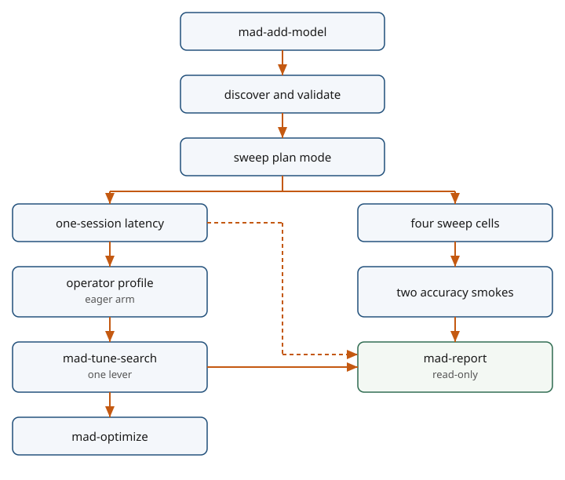

FastWAM predicts how the scene may evolve with a video model, then denoises a chunk of robot actions conditioned on that prediction. The two models share attention. At inference the predicted video is not displayed.

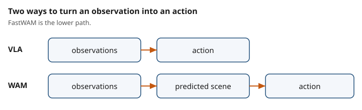

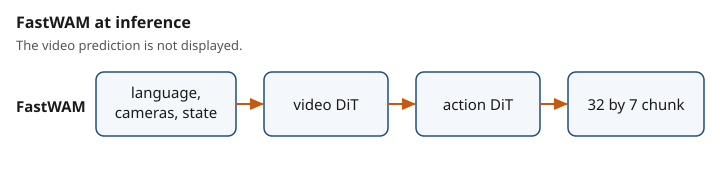

The post compares four latency arms:

- **eager**: PyTorch eager, the unmodified baseline.
- **compile**: `torch.compile`, the compiler step.
- **GEAK**: the GEAK kernel tree shipped with `faster-action-models`, at 10 denoising steps.
- **GEAK at 2 steps**: the same tree with fewer denoising steps. A 40-task smoke checks that episodes still finish.

**Prompt**

```text
In the MAD repo, explain how a skill, an agent, and a workflow differ, using mad-benchmark, mad-benchmark-runner, and mad-benchmark-sweep. Then name mad-tune-search and mad-optimize, and say which one is allowed to return a different kernel tree. Do not run anything.
```

## 2. Register the model

Every FastWAM arm is one entry in `scripts/pyt_fam/models.json`, and all of them share one image and one run script. The image clones `AMD-AGI/faster-action-models` at a fixed commit. FastWAM's own launchers start a container, but madengine has already started one, so the run script calls the in-image Python entry points directly. It ends by printing one `performance: <value> <unit>` line, which madengine records. Latency is in `ms`, lower is better. Accuracy is `success_rate`, higher is better.

A new arm is one more object in that registry. Paths are relative to the registry directory, and madengine appends `.ubuntu.amd.Dockerfile` to the `dockerfile` prefix:

```json
{
  "name": "pyt_fam_fastwam_rollout",
  "dockerfile": "../../docker/pyt_fam",
  "scripts": "run.sh",
  "url": "",
  "n_gpus": "1",
  "owner": "mad.support@amd.com",
  "training_precision": "",
  "timeout": 14400,
  "tags": ["pyt", "pyt_fam", "inference", "fam", "fastwam", "rollout"],
  "args": "--mode frames"
}
```

`/mad-add-model` asks for the name, the repository, the GPU count, the precision, and the owner, then checks that the name is unused before it writes. The validator checks the registry without a GPU:

```text
$ python3 tools/validation/model_config_validator.py --model pyt_fam_fastwam_latency
✅ All validation checks passed!
```

**Prompt, validate**

```text
/mad-validate-model pyt_fam_fastwam_latency

Quote the pass or fail line. Do not build an image and do not start a GPU job.
```

**Prompt, add-model duplicate check**

```text
/mad-add-model

The model is already registered. Do not write files and do not create a second entry. Walk the skill against pyt_fam_fastwam_rollout and stop when the duplicate check finds it.

Answers, so you do not have to ask: framework pyt, project fam, workload fastwam_rollout, full name pyt_fam_fastwam_rollout. Repository URL empty. Inference. 1 GPU. Precision empty. Owner mad.support@amd.com. The directory is scripts/pyt_fam, dockerfile is ../../docker/pyt_fam, scripts is run.sh, args are --mode frames, timeout is 14400. Tags are pyt, pyt_fam, inference, fam, fastwam, rollout.

Run madengine discover --tags pyt_fam_fastwam_rollout and quote the model it lists. Then run python3 tools/validation/model_config_validator.py --model pyt_fam_fastwam_rollout and quote the pass or fail line.
```

## 3. Plan the sweep, then run it

In plan mode, `mad-benchmark-sweep` prints one command per cell and runs nothing: 4 cells planned, 0 ran. In `docker_mounts`, the key is the container path and the value is the host directory:

```text
madengine run --tags 'pyt_fam/pyt_fam_fastwam_eager' --live-output --additional-context '{"docker_mounts":{"/myworkspace/fam_cache":"<host-weights-dir>"},"docker_env_vars":{"FAM_CACHE":"/myworkspace/fam_cache"}}'
madengine run --tags 'pyt_fam/pyt_fam_fastwam_compile' --live-output --additional-context '{"docker_mounts":{"/myworkspace/fam_cache":"<host-weights-dir>"},"docker_env_vars":{"FAM_CACHE":"/myworkspace/fam_cache"}}'
madengine run --tags 'pyt_fam/pyt_fam_fastwam_geak' --live-output --additional-context '{"docker_mounts":{"/myworkspace/fam_cache":"<host-weights-dir>"},"docker_env_vars":{"FAM_CACHE":"/myworkspace/fam_cache"}}'
madengine run --tags 'pyt_fam/pyt_fam_fastwam_geak2' --live-output --additional-context '{"docker_mounts":{"/myworkspace/fam_cache":"<host-weights-dir>"},"docker_env_vars":{"FAM_CACHE":"/myworkspace/fam_cache"}}'
```

Planning also catches a bad tag before any GPU time is spent. Adding the unregistered `pyt_fam_dit4dit` gives that cell `error: No models found corresponding to the given tag`, and the other four stay planned.

**Prompt, plan**

```text
Run the mad-benchmark-sweep workflow. Use the Workflow tool. scriptPath is .claude/workflows/mad-benchmark-sweep.js. args must be a JSON object, not a string:

{"tags":["pyt_fam_fastwam_eager","pyt_fam_fastwam_compile","pyt_fam_fastwam_geak","pyt_fam_fastwam_geak2"],"execute":false,"additionalContext":{"docker_mounts":{"/myworkspace/fam_cache":"<host-weights-dir>"},"docker_env_vars":{"FAM_CACHE":"/myworkspace/fam_cache"}}}

Replace <host-weights-dir> with the directory that holds the weights. Do not run madengine run. Quote the four cell commands and the headline. Expect 4 cells planned and 0 ran.
```

**Prompt, run the four cells**

```text
Run the mad-benchmark-sweep workflow. Use the Workflow tool. scriptPath is .claude/workflows/mad-benchmark-sweep.js. args must be a JSON object, not a string:

{"tags":["pyt_fam_fastwam_eager","pyt_fam_fastwam_compile","pyt_fam_fastwam_geak","pyt_fam_fastwam_geak2"],"execute":true,"additionalContext":{"docker_mounts":{"/myworkspace/fam_cache":"<host-weights-dir>"},"docker_env_vars":{"FAM_CACHE":"/myworkspace/fam_cache"}}}

Replace <host-weights-dir> with the directory that holds the weights. This runs four cells, one at a time, on a GPU. Quote each performance line. Lower milliseconds are better.
```

## 4. The latency ladder

This table is a reproduction of the GEAK tree that [`faster-action-models`](https://rocm.blogs.amd.com/artificial-intelligence/faster-action-models/README.html) already ships, run on one MI350X. It is not a new optimization. The cited numbers come from one container that times all four arms in three interleaved rounds. Spread is `(max − min) / median`.

| arm | denoising steps | rounds (ms) | median (ms) | spread | vs eager |
|---|---:|---|---:|---:|---:|
| eager | 10 | 216.579, 223.929, 229.188 | 223.93 | 5.63% | 1.00× |
| compile | 10 | 87.373, 88.973, 89.335 | 88.97 | 2.21% | 2.52× |
| GEAK | 10 | 24.845, 24.899, 24.946 | 24.90 | 0.41% | 8.99× |
| GEAK at 2 steps | 2 | 9.921, 9.931, 9.959 | 9.93 | 0.38% | 22.55× |

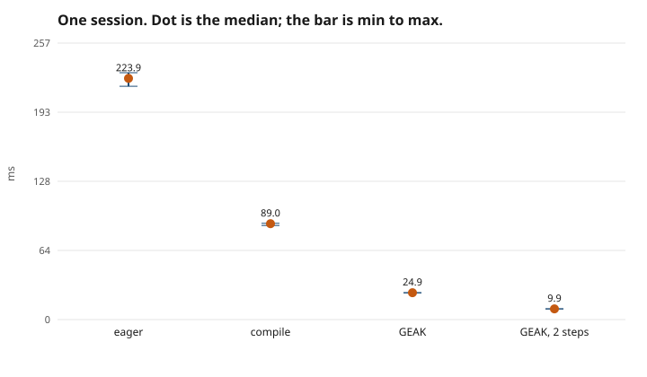

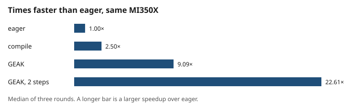

The sweep runs each arm as its own cell. It ran on two days, and both runs agree with the cited medians to within 2%:

| arm | cited median (ms) | sweep, day 1 (ms) | sweep, day 2 (ms) |
|---|---:|---:|---:|
| eager | 223.93 | 221.46 | 220.86 |
| compile | 88.97 | 90.64 | 90.64 |
| GEAK | 24.90 | 24.67 | 24.54 |
| GEAK at 2 steps | 9.93 | 9.89 | 9.90 |

On this GPU, GEAK is 3.57× faster than `torch.compile`. The published MI355X comparison is in the same band: `torch.compile` is 1.6–2.6× over eager, and the shipped GEAK tree is 3.7× faster than that compiled path. The published absolute times, on an MI355X, are 222.55 ms eager, 24.17 ms GEAK, and 9.59 ms at 2 steps. The MI350X medians above sit next to those figures. The two machines are not the same measurement, and the post does not treat the small gap between them as a result.

That speedup belongs to the kernel tree `faster-action-models` ships. The published write-up attributes it to HIP graph replay, wider projections, less dispatch and data movement, and a fixed-shape VAE, not to one kernel edit. MAD's part is a measurement anyone can repeat with the prompts below.

**Prompt, benchmark**

```text
/mad-benchmark pyt_fam_fastwam_latency

Mount the weights: additional-context {"docker_mounts":{"/myworkspace/fam_cache":"<host-weights-dir>"},"docker_env_vars":{"FAM_CACHE":"/myworkspace/fam_cache"}}. The model's multiple-results output has one row per arm, and that is the table to read. Report the four medians in ms. Lower is better.
```

**Prompt, report**

```text
/mad-report

Use the multiple-results output of the pyt_fam_fastwam_latency run you just finished. Lower milliseconds are better. Report the four medians and the ratio of each to the eager median. Do not compare them with a success rate.
```

## 5. Where eager spends its time

`/mad-profile` runs one depth per run. On the eager arm, the operator depth asks which kinds of PyTorch operations take the GPU time. It uses a 2-second profiler window after a 25-second warm-up:

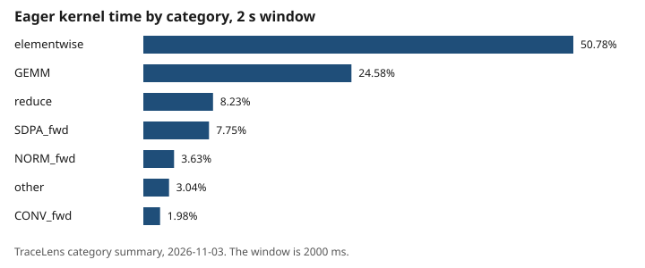

| category | share of kernel time |
|---|---:|
| elementwise | 50.78% |
| GEMM | 24.58% |
| reduce | 8.23% |
| attention (SDPA) | 7.75% |
| normalization | 3.63% |
| other | 3.04% |
| convolution | 1.98% |

The GPU is idle for 70% of that window. Eager mode issues many small kernels, one PyTorch operation at a time, and the GPU waits for the host in between. The dispatch depth agrees: no single kernel takes more than 8.6% of eager GPU time. The top kernel is a hipBLASLt GEMM, followed by a mean reduction, an elementwise multiply, and attention, each near 8%. The latency ladder in section 4 is what that wait costs once `torch.compile` or the shipped GEAK tree is used.

A run under a profiler is slower than a clean run, so its `performance:` line is evidence, not a score. That holds for every profiled run in this post.

**Prompt, operator depth**

```text
/mad-profile pyt_fam_fastwam_eager operator

One run, through mad-run.sh. Mount the weights the same way as the latency run. Set TORCH_PROFILE_ITERATIONS=0, TORCH_PROFILE_DURATION_MS=2000, TORCH_PROFILE_WARMUP_S=25, TORCH_PROFILE_WITH_STACKS=0, and TRACELENS_MODE=pytorch. Tools are torch_profiler_dynolog and tracelens. The performance line from this run is evidence, not a score. Report kernel time by category from the TraceLens summary.
```

**Prompt, dispatch depth**

```text
/mad-profile pyt_fam_fastwam_eager dispatch

One run, through mad-run.sh. Mount the weights the same way as the latency run. Warm the code-object cache first, then take a rocprofv3 kernel trace and rank it with kernel-tools.py rank. The performance line is evidence, not a score. Report the kernel-time share from kernel_rank.json.
```

## 6. Finding the real hotspot in the GEAK tree

The GEAK arm is already 9× faster than eager. The next question is which kernel inside it is worth optimizing, and the first answer was wrong.

**The trap: a cold trace.** The first dispatch capture on the GEAK arm put `triton_mm` at 66% of kernel time. That capture started with an empty compile cache. On a cold `torch.compile` run, `triton_mm` is Inductor timing autotune candidates, and those candidates never run again once the cache is warm. GPU utilization over that capture was 5.4%, because it included startup. Optimizing `triton_mm` would have chased compile time, not inference.

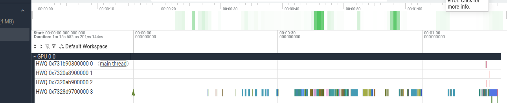

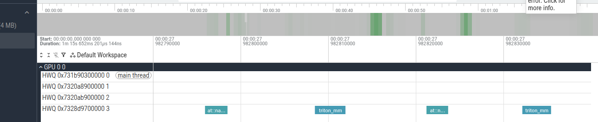

**The fix: warm first, then rank.** `/mad-profile` now runs the model once to fill the compile cache, then takes a rocprofv3 kernel trace and ranks kernels by GPU time. It uses rocprofv3 rather than the lighter `rocm_trace_lite`, because `rocm_trace_lite` does not see kernels replayed from HIP graphs, and the GEAK tree replays many of them. The warm trace recorded about 340,000 kernel launches:

| kernel | share of GPU kernel time | launches | average |
|---|---:|---:|---:|
| `_fw_skmm_kernel` | 14.6% | 58,680 | 5.01 µs |
| `_fw_skpost_kernel` | 13.7% | 57,376 | 4.79 µs |
| fused addmm and layer norm | 7.4% | 19,560 | 7.62 µs |
| `_fw_qrms_attn_kernel` | 7.2% | 19,560 | 7.42 µs |
| `_fw_attn_kernel` | 7.1% | 23,580 | 6.04 µs |
| `_fw_pfsk_kernel` | 5.8% | 8,040 | 14.39 µs |
| fused addmm and GELU | 5.6% | 19,560 | 5.78 µs |
| fill | 5.5% | 33,578 | 3.26 µs |

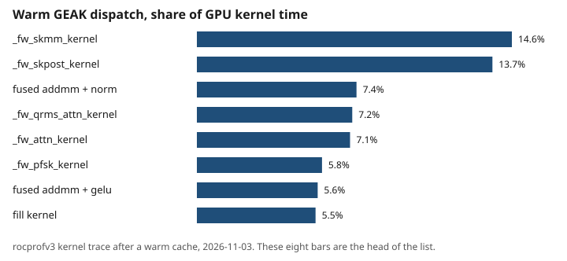

No kernel dominates. The top one, `_fw_skmm_kernel`, is a split-K matrix multiply: it splits the long inner dimension across workgroups, and a second kernel adds the partial results.

**Why that kernel is slow.** The kernel depth collects hardware counters for that one kernel and reduces them to a kernel card:

| | `_fw_skmm_kernel` |
|---|---|
| duration under counters | 4.32 µs |
| achieved bandwidth | 28.3% of the MI350X peak (8.0 TB/s) |
| achieved matrix-core throughput | 2.2% of peak |
| bound | bandwidth |
| PC sampling | 68% of samples waiting on memory (`s_waitcnt`) |

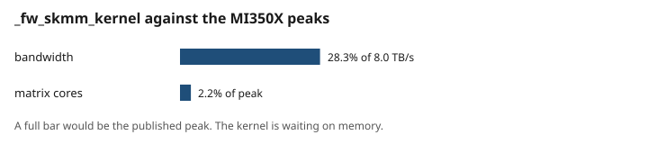

The kernel moves data far faster than it computes, and it spends most of its time waiting for memory. More matrix-core work would not help. The published 9.2× came from cutting launches and data movement across the model. What is left for a further edit is the same kind of change at a smaller scale: fewer bytes, or folding the separate reduction launch into the multiply. Retuning the tile of this one kernel cannot repeat the 9×.

**Prompt, dispatch depth**

```text
/mad-profile pyt_fam_fastwam_geak dispatch

One run, through mad-run.sh. Mount the weights the same way as the latency run. Warm the code-object cache first, then take a rocprofv3 kernel trace and rank it with kernel-tools.py rank. Do not use rocm_trace_lite to name the top kernel: it misses kernels replayed from HIP graphs. The performance line from the traced run is evidence, not a score. Report the kernel-time share from kernel_rank.json.
```

**Prompt, kernel depth**

```text
/mad-profile pyt_fam_fastwam_geak kernel

One run, through mad-run.sh, after the warm dispatch rank above. Collect rocprofv3 counters for _fw_skmm_kernel only, then build the kernel card with kernel-tools.py card. Report the bound, the percent of peak bandwidth, and the percent of peak MFMA. Then run PC sampling and report the top stall reasons. The performance line from a profiled run is evidence, not a score.
```

## 7. Trying a change, and the rule that decides

A kernel or setting that is faster in isolation does not always make the model faster. MAD's tuning workflows measure the whole model before and after a change, and keep the change only if:

- both sides have at least two clean samples,
- lower median latency wins, and
- the improvement beats the larger spread of the two sides and a 1% floor.

Two changes went through that rule.

**A GEAK kernel patch (`mad-optimize`, budget 1).** `mad-optimize` handed `_fw_skmm_kernel` to GEAK with one attempt. GEAK retuned two defaults: the split-K reduction and the tile size for the K=4096 shape. On its own kernel test, the kernel went from 5.150 µs to 4.959 µs, a 1.04× speedup. Then the whole model was measured twice with the shipped tree, and twice with the patched tree mounted in its place, under `mad-optimize`'s keep rule:

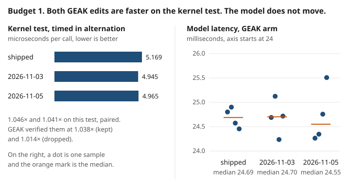

| tree | samples (ms) | median (ms) |
|---|---|---:|
| shipped | 24.80, 24.87 | 24.83 |
| patched | 35.88, 24.79 | 30.34 |

The gate does not keep the patch. The two patched samples are 24.79 ms and 35.88 ms, so their median is not evidence that the model got slower. The better sample is 0.16% under the shipped median, inside the 1% floor, and the other sample is far outside the shipped spread. With two samples the only supported result is "not kept."

That result also matches the kernel card. `_fw_skmm_kernel` is 14.6% of GPU kernel time, so a 4% gain on it is worth about 0.5% of GPU kernel time at most. A later attempt has to cut launches or bytes, for example by folding the separate reduction into the multiply. Another pass over the same tile defaults would be the change this gate already refused.

**A GEMM setting (`mad-tune-search`).** In plan mode, `mad-tune-search` proposed `PYTORCH_TUNABLEOP_ENABLED=1`, which lets PyTorch pick among rocBLAS GEMM implementations. It changes no tracked file. On the GEAK arm, two clean baseline runs measured 24.90 and 24.93 ms. The tuning run measured 25.29 ms and wrote no results file, and the one clean candidate run measured 25.00 ms. TunableOp is not kept. The GEAK tree's hot matrix multiplies are its own Triton kernels, which TunableOp does not touch.

One measurement tip from that run: `madengine run -m <manifest>` reuses profiling tools a previous run saved into the same manifest. Pass `"tools": []` in the additional context for a clean measurement.

**Prompt, mad-optimize plan**

```text
Run the mad-optimize workflow in plan mode. Use the Workflow tool. scriptPath is .claude/workflows/mad-optimize.js. args must be a JSON object, not a string:

{"tag":"pyt_fam_fastwam_geak","smokeTag":"pyt_fam_fastwam_geak2_smoke","budget":1,"repeats":2,"execute":false,"additionalContext":{"docker_mounts":{"/myworkspace/fam_cache":"<host-weights-dir>"},"docker_env_vars":{"FAM_CACHE":"/myworkspace/fam_cache"}}}

Do not run madengine run. Do not spend the budget. Quote the kernel it names and confirm execute is false.
```

To spend the budget, send the same object with `"execute": true`.

**Prompt, mad-tune-search plan**

```text
Run mad-tune-search. Use the Workflow tool. scriptPath is .claude/workflows/mad-tune-search.js. args must be a JSON object:

{"tag":"pyt_fam_fastwam_geak","target":"latency","depth":"dispatch","repeats":2,"candidates":1,"execute":false,"additionalContext":{"docker_mounts":{"/myworkspace/fam_cache":"<host-weights-dir>"},"docker_env_vars":{"FAM_CACHE":"/myworkspace/fam_cache"}}}

Do not run madengine run. Quote the proposed lever and confirm execute is false.
```

**Prompt, measure one lever by hand**

```text
/mad-tune pyt_fam_fastwam_geak latency

Mount the weights the same way as the latency run, and pass "tools": [] so no profiler runs. Run two clean baseline repeats. The lever is an environment change: PYTORCH_TUNABLEOP_ENABLED=1, with PYTORCH_TUNABLEOP_FILENAME pointed at the weights cache. Run two candidate repeats. Keep the lever only when the improvement beats max(baseline spread, candidate spread, 1%). Lower milliseconds win. Do not edit a tracked file.
```

## 8. A smoke at 2 steps

Fewer denoising steps are only useful if the robot still succeeds. These smokes run one trial of each of 40 LIBERO tasks, 10 per suite. They are a check that a broken kernel did not land, not the published accuracy study. That study reports the mean of 11 full LIBERO runs on an MI355X: 96.86% for the shipped GEAK tree and 97.00% at 2 denoising steps. Higher `success_rate` is better:

| arm | spatial | object | goal | long | success_rate |
|---|---:|---:|---:|---:|---:|
| eager | 10/10 | 10/10 | 10/10 | 10/10 | 1.000 |
| GEAK at 2 steps | 10/10 | 10/10 | 9/10 | 10/10 | 0.975 |

The one miss was a goal-suite task. An earlier pair of smokes solved all 40 tasks on both arms. One miss in 40 single-trial episodes sits near the published 97% and does not measure a difference between the two arms.

`pyt_fam_fastwam_rollout` saves frames from four tasks, one per suite, for both arms. All eight episodes succeeded. The top row is eager, and the bottom row is GEAK at 2 steps:

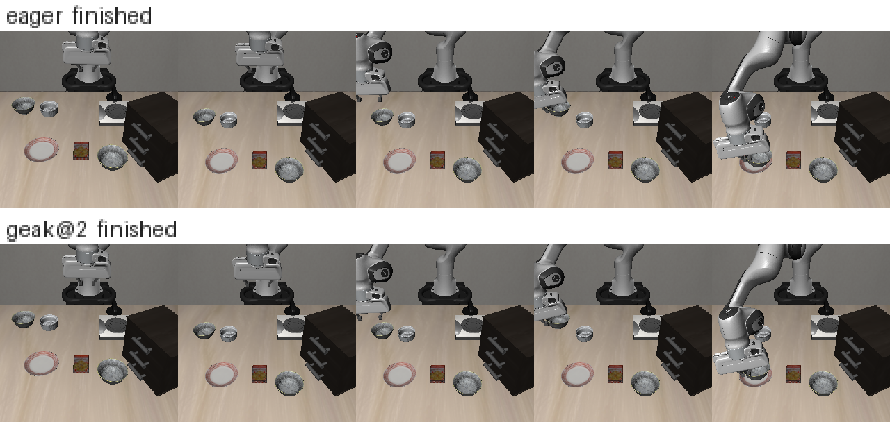

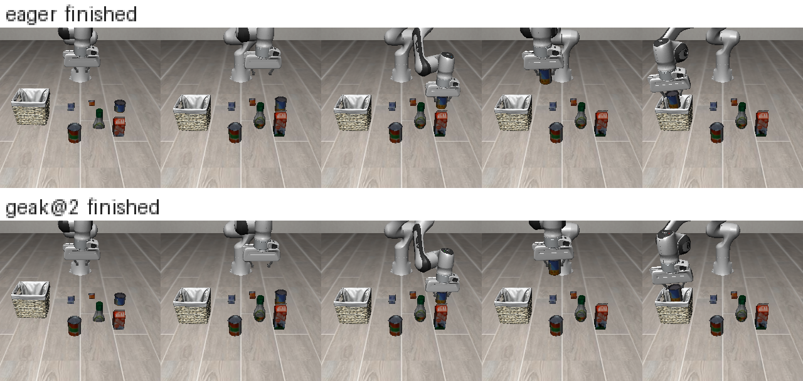

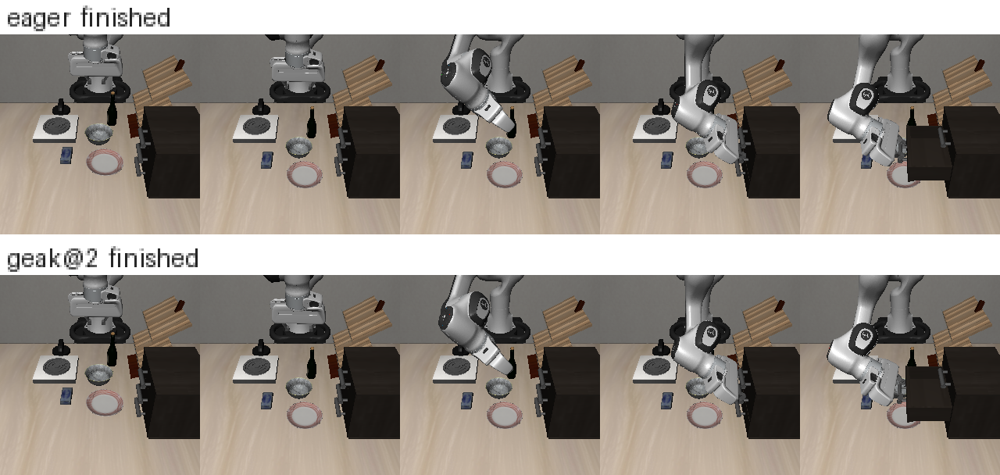

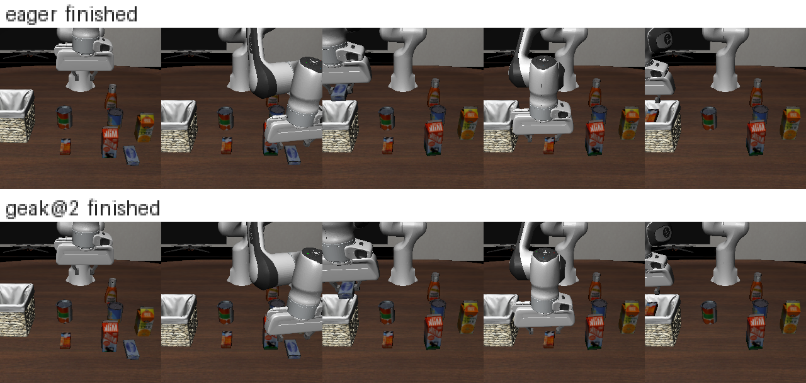

**Prompt, smokes**

```text
/mad-benchmark pyt_fam_fastwam_eager_smoke,pyt_fam_fastwam_geak2_smoke

Mount the weights the same way as the latency run. Report each performance line. The metric is success_rate. Higher is better. Do not place these rates in a table with milliseconds.
```

**Prompt, compare**

```text
/mad-report

Compare the eager smoke with the GEAK-at-2-steps smoke from the runs you just finished. Higher success_rate is better. Do not compare them with milliseconds.
```

**Prompt, rollouts**

```text
/mad-benchmark pyt_fam_fastwam_rollout

Mount the weights the same way as the latency run. It is one trial of four tasks for eager and for GEAK at 2 steps. Report the eight episode lines.
```

## 9. A second checkpoint: CAE-FastWAM

CAE-FastWAM (`amd/CAE-FastWAM`) is a different checkpoint, so it is its own model, `pyt_fam_cae_fastwam_latency`, not a fifth sweep cell. The run uses the `cae-fastwam` tree at 10 denoising steps with compile enabled. It measured 13.59 ms, and 13.64 ms on a second day, one sample each. The published MI355X figure for GEAK plus the Compact Action Expert at 10 steps is 12.82 ms, with 97.28% success over full LIBERO runs. These two samples are a latency check on a different GPU. They do not reproduce that success rate.

**Prompt**

```text
/mad-benchmark pyt_fam_cae_fastwam_latency

Mount the weights the same way as the latency run. Report the performance line. It is milliseconds, lower is better.
```

## 10. Limitations

- Everything ran on one GPU of a shared eight-GPU host. The cited latency table has three rounds per arm, and the sweep cells have one sample each.
- The smokes run one trial per task. They check that the 2-step arm still finishes tasks. They are not the published 11-run LIBERO evaluation, and they do not establish accuracy parity.
- The patched-model samples in section 7 are 24.79 ms and 35.88 ms. The run does not show why they differ. With two samples, the result is "not kept." It is not a measured slowdown.
- Hardware-counter collection on the eager arm did not finish: the GPU went idle while the host waited. PC sampling finished and ranked the same hipBLASLt GEMM first.
- The assembly view found two compiled variants of `_fw_skmm_kernel` with the same register count, so it does not attribute the kernel card to either one.

## Setup

| | |
|---|---|
| GPU | AMD Instinct MI350X (gfx950), one per run, on an 8-GPU host |
| Base image | `rocm/pytorch:rocm7.14_ubuntu24.04_py3.12_pytorch_release_2.11.0` |
| PyTorch | `2.11.0+rocm7.14.0` |
| Model source | `AMD-AGI/faster-action-models` @ `a5fa731` |
| Weights | released FastWAM and CAE-FastWAM checkpoints, mounted from a host directory at `/myworkspace/fam_cache` |
| Benchmark | LIBERO in simulation, one trial per task |

If Docker Hub refuses to pull the base image, build from a local copy with `madengine build --use-image <local tag>`, then run that manifest with `madengine run -m <manifest>`.

Related reading: [Optimizing World Action Models on AMD GPUs](https://rocm.blogs.amd.com/artificial-intelligence/faster-action-models/README.html).
