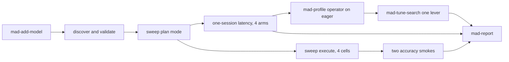

# Hands-on MAD: World Action Models

This post uses one workload, FastWAM on LIBERO, to show how MAD's skills, agents, and workflows fit together. The source numbers are the ROCm post [Optimizing World Action Models on AMD GPUs](https://rocm.blogs.amd.com/artificial-intelligence/faster-action-models/README.html). Every number below is from a command captured in `docs/blog/transcripts/`. The host is 8× AMD Instinct MI350X (gfx950). The source post measured MI355X, so the comparison is the shape of the ladder, not the absolute milliseconds.

## Four arms, and why that count

The sweep is `mad-benchmark-sweep`. Each tag is one cell. Cells run one at a time. There is no precision axis: a different configuration is a different model entry.

Four FastWAM-on-LIBERO latency arms:

- **eager** — the baseline the profiler and the tuner both start from.
- **torch.compile** — the lever `mad-tune` already knows how to name. The source post uses it as the comparison that shows GEAK is a larger step than compile.
- **GEAK** — the kernel tree shipped in `src/fastwam-geak`, at 10 denoising steps.
- **GEAK at 2 denoising steps** — a latency win that still needs a success-rate check.

Two arms would hide compile and the step-count gate. Three arms, dropping compile, would hide the comparison the source post uses. A fifth CAE arm would mix a second checkpoint into a sweep whose axis is one optimization flag, so CAE is its own benchmark. DiT4DiT and RoboCasa repeat the same levers on a second image and more Python environments; they appear here only as a plan-mode tag that is not registered. Full LIBERO accuracy (thousands of episodes, many repeats) does not teach another MAD mechanism. Two smoke runs, one trial per task, are the gate.

The cited latency table is one madengine model that times all four arms inside one session, the same reason the upstream `compare_artifacts.py` interleaves them: latency drifts across sessions. The sweep still runs the four arms as separate cells, because that is the workflow this post is teaching. The effect sizes are large enough that the drift does not reorder the ladder. Both tables are below. The one-session table is the citation.

## 1. Skill, agent, workflow

MAD has three layers.

A **skill** is the procedure: `mad-benchmark`, `mad-profile`, `mad-tune`, `mad-report`, `mad-add-model`. The ones that build or run are explicit. An agent does not pick them up on its own.

An **agent** is who carries the procedure out. `mad-benchmark` and `mad-profile` run in `mad-benchmark-runner`. `mad-tune` runs in `mad-tuner`. `mad-report` runs in `mad-perf-analyst`. The analyst is read-only. It never starts a GPU job, and it never compares a millisecond with a success rate.

A **workflow** fans the procedure out. `mad-benchmark-sweep` and `mad-tune-search` live in `.claude/workflows/` and run in Claude Code. They plan by default: they resolve tags and print every command. `--execute` is what touches GPUs. Executed cells go through `.claude/skills/mad-common/mad-run.sh`, which holds a host-wide GPU lock so two runs do not share the card.



GPU commands in this post were started with `mad-run.sh`. The plan-mode sweep, the executed sweep, the tune-search plan, and the GEAK handoff were Claude Code workflow sessions (`docs/blog/transcripts/03`, `04`, `06`, `08`, `11`). The lock serializes the rest.

## 2. One directory, one image, no nested docker

FastWAM's own launchers (`eval/native/run_fastwam_libero.sh`, `geak/task/run_local.sh`) start a container. madengine has already started one. Nesting `docker run` under that breaks the host-path mounts, so `scripts/pyt_fam/run.sh` calls the in-image Python entry points and stops there.

The image is `docker/pyt_fam.ubuntu.amd.Dockerfile`. The first line is the context header madengine requires. The base is the source post's pin, `rocm/pytorch:rocm7.14_ubuntu24.04_py3.12_pytorch_release_2.11.0`. The image clones `AMD-AGI/faster-action-models` at `a5fa73101988870e51f04fe1e7be5da56dda3841` and builds the LIBERO simulator for gfx950. `url` on every registry entry is empty: the tree is already in the image, and a second clone collides with files the registry directory already contains.

Eight entries share that image, in `scripts/pyt_fam/models.json`. Latency is `ms` (lower is better). Accuracy is `success_rate` (higher is better). The interleaved entry is the one that writes a `multiple_results` CSV:

```json
{
  "name": "pyt_fam_fastwam_latency",
  "dockerfile": "../../docker/pyt_fam",
  "scripts": "run.sh",
  "url": "",
  "n_gpus": "1",
  "multiple_results": "perf_fam_latency.csv",
  "args": "--mode interleaved --rounds 3 --csv perf_fam_latency.csv"
}
```

The other seven are `pyt_fam_fastwam_eager`, `_compile`, `_geak`, `_geak2`, the two smokes, and `pyt_fam_cae_fastwam_latency`.

```text
$ python3 tools/validation/model_config_validator.py --model pyt_fam_fastwam_latency
✅ All validation checks passed!
```

Full output: `docs/blog/transcripts/00-validator.txt`.

## 3. Discover, then a sweep that does not run

Pre-flight confirms madengine is on `PATH` and the working directory is the repo root (`docs/blog/transcripts/01-preflight.txt`). Discover then lists the eight models as `pyt_fam/<name>` (`docs/blog/transcripts/02-discover.txt`).

The sweep in plan mode resolves the four latency tags and prints a command per cell. Nothing runs. From `docs/blog/transcripts/03-sweep-plan.txt`, workflow `wf_d3bbf0ad-6e0`, `execute: false`:

```text
madengine run --tags 'pyt_fam/pyt_fam_fastwam_eager' --live-output -o perf_pyt_fam_pyt_fam_fastwam_eager.csv
madengine run --tags 'pyt_fam/pyt_fam_fastwam_compile' --live-output -o perf_pyt_fam_pyt_fam_fastwam_compile.csv
madengine run --tags 'pyt_fam/pyt_fam_fastwam_geak' --live-output -o perf_pyt_fam_pyt_fam_fastwam_geak.csv
madengine run --tags 'pyt_fam/pyt_fam_fastwam_geak2' --live-output -o perf_pyt_fam_pyt_fam_fastwam_geak2.csv
```

Headline from that session: 4 cells planned, 0 ran.

The same workflow with `pyt_fam_dit4dit` added stays in plan mode (`docs/blog/transcripts/04-sweep-plan-unregistered.txt`, workflow `wf_09c1745e-612`). That tag is not in the registry. The cell status is `error`: `No models found corresponding to the given tag: pyt_fam_dit4dit`. The other four stay planned. An unresolved tag is a row in the report, and it is not a success.

## 4. The cited table, and the sweep's own table

The cited run is one container, four arms, three interleaved rounds. madengine reads `perf_fam_latency.csv` (`model,performance,metric`) and prefixes the registry name onto each row.

```text
$ bash .claude/skills/mad-common/mad-run.sh start fam-latency-3 -- \
    madengine run --tags pyt_fam_fastwam_latency --live-output -o perf_fam_interleaved.csv
```

`MAD_RUN_STATUS=succeeded`. Device line from the log: AMD Instinct MI350X, torch `2.11.0+rocm7.14.0`. Medians from `docs/blog/transcripts/05-interleaved-latency.txt`:

| arm | steps | median ms | spread |
|---|---:|---:|---:|
| eager | 10 | 225.782 | 6.22% |
| compile | 10 | 87.539 | 9.09% |
| geak | 10 | 24.562 | 0.74% |
| geak@2 | 2 | 10.015 | 0.62% |

File: `perf_fam_latency.csv`. Against eager, compile is 2.58×, the shipped GEAK tree is 9.19×, and GEAK at 2 steps is 22.54×. GEAK is 3.56× past compile. The source post's MI355X ladder is eager 222.55 ms, GEAK 24.17 ms (about 9×, and about 3.7× past compile), GEAK at 2 steps 9.59 ms (about 23×). Same shape, on a different GPU.

`mad-report` on that CSV is `docs/blog/transcripts/10-report-latency.txt`. Lower is better. It does not mention the smoke rate.

The sweep then executed the four cells (`docs/blog/transcripts/06-sweep-execute.txt`, Claude Code workflow `wf_457899fa-d31`). Each cell had its own CSV. The eager cell's agent was denied on a chained shell command, so that cell's command was started with `mad-run.sh` and recorded as its own run. The print session stopped at its 10-minute ceiling while the geak@2 container was still in `wait`; that container finished on its own. Separate sessions, so the milliseconds move:

| cell | ms | file |
|---|---:|---|
| eager | 237.2072 | `perf_pyt_fam_pyt_fam_fastwam_eager.csv` |
| compile | 91.2376 | `perf_pyt_fam_pyt_fam_fastwam_compile.csv` |
| geak | 24.8130 | `perf_pyt_fam_pyt_fam_fastwam_geak.csv` |
| geak@2 | 9.8860 | `perf_pyt_fam_pyt_fam_fastwam_geak2.csv` |

Against this session's eager number the ratios are 2.60×, 9.56×, and 24.0×. The order matches the cited table. The citation stays the one-session CSV.

## 5. Operator profile, and the 87% claim

The source post attributes about 87% of eager time to action denoising, as a PyTorch module share. Operator depth is the one that can check a module share. One depth only, on `pyt_fam_fastwam_eager`.

The first capture asked dynolog for 4000 ms with stacks enabled. The request was accepted, the Kineto file stayed a 0-byte temporary, the GPU went idle, and the process slept. That run was stopped (`fam-profile-eager`, exit `stopped`). The second capture turned stacks off, used a 2000 ms window, and finished:

```text
$ bash .claude/skills/mad-common/mad-run.sh start fam-profile-eager-2 -- \
    madengine run --tags pyt_fam/pyt_fam_fastwam_eager --live-output \
    -o perf_fam_profile_eager.csv --additional-context '<tools: torch_profiler_dynolog + tracelens, TRACELENS_MODE=pytorch>'
```

`performance: 292.2085 ms`. That number was measured under the profiler. It is evidence, not a score. TraceLens wrote `tracelens_output/tracelens_summary.json` with status `SUCCESS`. The kernel-time mix in the 2 second window is elementwise 51.15%, GEMM 24.55%, reduce 8.11%, SDPA 7.66%, normalization 3.57%, other 3.00%, convolution 1.95%. The GPU timeline in that window is 35.70% computation and 64.25% idle.

The Kineto categories are `cpu_op`, `kernel`, `cuda_runtime`, and a little memcpy. There are no `nn.Module` events, so this capture does not measure the 87% module share. Transcript: `docs/blog/transcripts/07-profile-eager.txt`. Files: `torch_profiler_output/libkineto_trace_1558.json`, `tracelens_output/`.

## 6. One tuner lever, then the smoke gate

`mad-tune-search` in plan mode (`docs/blog/transcripts/08-tune-search-plan.txt`, workflow `wf_f7085b92-00f`) resolved `pyt_fam_fastwam_geak`, target latency, depth dispatch, two repeats, one candidate, `execute: false`. Dispatch was skipped because nothing had been profiled yet. The propose step named `FASTWAM_KVSLAB=1`. The in-container driver forces `FASTWAM_KVSLAB=0` on the GEAK arm, so that variable would not change the process. The lever this post measured is `PYTORCH_TUNABLEOP_ENABLED=1`.

Dispatch evidence, one `rocm_trace_lite` run, `performance: 25.2028 ms` (profiled, not a clean score). `rocm_trace_lite_output/trace_summary.txt` puts `triton_mm` at 65.9% of kernel time. The same file reports GPU utilization 5.41% over a 75 s wall, because the trace includes startup.

Clean repeats, no profiler (`docs/blog/transcripts/09-tune-execute.txt`):

| side | samples (ms) | median (ms) | spread |
|---|---|---:|---:|
| baseline | 25.0754, 25.5096 | 25.2925 | 1.72% |
| `PYTORCH_TUNABLEOP_ENABLED=1` | 24.5579, 24.8667 | 24.7123 | 1.25% |

The workflow's gate keeps a candidate only when both sides have two samples, the metric matches, and the improvement beats the larger spread (and beats 1%). The improvement here is 2.29%, and the noise floor is 1.72%, so that numeric gate passes. It is still not kept. Unmodified GEAK on this host the same day already spans 24.431 ms to 25.510 ms. Both TunableOp samples sit inside that span. No tracked file changed. The 9× above is the tree the image already contained.

The 2-step arm is the one that needs a success rate beside it. Two smokes, `--sim instinct` via the gfx950 build, one trial on each of 40 tasks (four LIBERO suites, tasks 0–9):

| model | result | rate | file |
|---|---|---:|---|
| eager | 40/40 | 1.0000 success_rate | `perf_fam_smoke_eager.csv` |
| GEAK at 2 steps | 40/40 | 1.0000 success_rate | `perf_fam_smoke_geak2.csv` |

`docs/blog/transcripts/12-smokes-and-cae.txt` and `docs/blog/transcripts/10-report-smoke.txt`. These are smoke runs on MI350X. They are not the source post's 11-run MI355X means (eager 96.95%, GEAK 96.86%, GEAK at 2 steps 97.00%). A single trial per task can pass every task and still not be that mean. The report compares the two rates with each other. It does not compare them with milliseconds.

## 7. CAE is a second model

CAE-FastWAM is a different checkpoint (`amd/CAE-FastWAM`), so it is a different registry entry, `pyt_fam_cae_fastwam_latency`, run at 10 denoising steps. It is not a fifth cell of the sweep.

```text
performance: 13.5792 ms
```

File: `perf_fam_cae.csv`. The source post's GEAK+CAE row at 10 steps is 12.82 ms on MI355X. This run is latency only. It uses the released weights. It does not retrain CAE.

## 8. Where GEAK would start, and where this post stops

GEAK is a Claude Code workflow too. Its entry point for a kernel tree is `kernel_workflow.js`, pinned here at `fa86fd1`. `e2e_workflow` targets SGLang and vLLM, so it is the wrong entry point for FastWAM. The invocation that points `kernel_workflow` at the shipped task, with the budget left unset, is `docs/blog/transcripts/11-geak-handoff.txt`:

```text
Workflow({
  scriptPath: "<GEAK checkout at fa86fd1>/kernel_workflow.js",
  args: {
    kernel_path: "/opt/faster-action-models/geak/task",
    workflow_dir: "<GEAK checkout at fa86fd1>",
    task: "Measure the shipped FastWAM tree at kernel_path. Do not edit it."
  }
})
```

That workflow was not run. No budget was spent. The latencies in this post are the tree `faster-action-models` already ships under `src/fastwam-geak`.

## 9. The machine, once

| | |
|---|---|
| Host | `smci350-rck-g03-b06-40`, 8× AMD Instinct MI350X, gfx950 |
| Image | `rocm/pytorch:rocm7.14_ubuntu24.04_py3.12_pytorch_release_2.11.0` |
| Tree | `AMD-AGI/faster-action-models` @ `a5fa731` |
| Torch in the container | `2.11.0+rocm7.14.0` |
| Cited latency | one session, four arms, `perf_fam_latency.csv`, milliseconds, lower is better |
| Sweep | the same four arms as separate cells, a second table |
| Accuracy | two smokes, 40 episodes each, one trial per task, `success_rate`, higher is better |
| Source post | MI355X means over a full eval. This post does not replace those means. |

Weights were cached on the host at `/var/tmp/fam_cache` and mounted into later containers. The first interleaved session downloaded them. Later cells reused the mount so they measured the same checkpoints.
