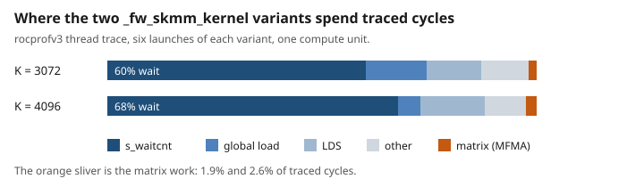

# Hands-on MAD skills, agents, and workflows: World Action Models

This post runs MAD on one workload: FastWAM, a world action model, on the LIBERO robot benchmark. Every run is a container on one AMD Instinct MI350X (gfx950). The path is the one a user actually takes: register the model, benchmark it, profile it from the operator down to one kernel, try a change, and decide whether to keep it.

The fast kernels come from [`faster-action-models`](https://rocm.blogs.amd.com/artificial-intelligence/faster-action-models/README.html), which ships a GEAK-optimized kernel tree for FastWAM. MAD did not write those kernels. MAD measured them, explained where the time goes, and tested one further change.

## Key takeaways

- **The released GEAK ladder reproduces on MI350X.** The published MI355X times are 222.55 ms eager, 24.17 ms for the shipped GEAK tree (9.2×), and 9.59 ms at 2 denoising steps (about 23×). The same three arms on one MI350X measure 225.90, 24.85, and 9.99 ms. Two later runs on the same GPU landed within 2% of those medians. MAD measured this tree. It did not create the 9×.
- **The warm profile names the real hotspot.** A cold trace says `triton_mm` is 66% of kernel time, but that is `torch.compile` autotuning. After a warm cache, the top kernel is `_fw_skmm_kernel` at 14.8%. Its kernel card says it is bandwidth-bound, and a rocprofv3 thread trace shows that both of its compiled variants spend most of their cycles waiting on global loads.
- **The keep rule refuses a kernel-only win and keeps a host-side one.** A budget-1 GEAK patch made `_fw_skmm_kernel` 1.0378× faster on its own test, but two end-to-end samples do not clear the keep rule, so `mad-optimize` leaves the shipped tree in place. That is "not kept," not a measured regression. In the rerun, two budget-1 GEAK runs found nothing faster. TunableOp is not kept either. Pinning the eager arm to its GPU's NUMA-local CPU cores is kept: 3.6% faster, against 1.1% noise.
- **A 40-task smoke stays in the same range as the published evaluation.** GEAK at 2 steps solved 40 of 40 tasks and eager solved 37 of 40, one trial each. The published MI355X evaluation, a mean of 11 full LIBERO runs, is 96.86% for GEAK and 97.00% at 2 steps. The smoke is consistent with that range. It is not that evaluation.
- **The prompts that reproduce each section are collected in the appendix.** Four of them stay in the text, at the step where the prompt itself is the lesson. Paste them into Claude Code from the MAD repo root.

## How to read this post

The result comes first, then the tool that produced it, then the profiling and the keep-or-drop decision. The appendix holds the prompts.

A skill that builds, runs, or writes files starts with a slash command: `/mad-add-model`, `/mad-benchmark`, `/mad-profile`, or `/mad-tune`. A plain sentence does not start one. `/mad-validate-model` and `/mad-report` are read-only.

The three workflows, `mad-benchmark-sweep`, `mad-tune-search`, and `mad-optimize`, are not slash commands. They start through Claude Code's Workflow tool, with a JSON object as `args`, and they only plan unless `execute` is `true`. Claude Code asks you to approve a workflow before it runs. A headless `claude -p` session cannot answer that prompt, so pass it `--allowedTools Workflow`. GPU runs go through `mad-run.sh`, which queues runs so two jobs never share a GPU.

Every prompt mounts the model weights from a host directory. Replace `<host-weights-dir>` with that directory.

## 1. The workload

FastWAM predicts how the scene may evolve with a video model, then denoises a chunk of robot actions conditioned on that prediction. The two models share attention. At inference the predicted video is not displayed.


The post compares four latency arms:

- **eager**: PyTorch eager, the unmodified baseline.
- **compile**: `torch.compile`, the compiler step.
- **GEAK**: the GEAK kernel tree shipped with `faster-action-models`, at 10 denoising steps.
- **GEAK at 2 steps**: the same tree with fewer denoising steps. A 40-task smoke checks that episodes still finish.

## 2. The latency ladder

This table is a reproduction of the GEAK tree that [`faster-action-models`](https://rocm.blogs.amd.com/artificial-intelligence/faster-action-models/README.html) already ships, run on one MI350X. It is not a new optimization. The cited numbers come from one container that times all four arms in three interleaved rounds, on 2026-11-05 with nothing else running on the node. Spread is `(max − min) / median`.

| arm | denoising steps | rounds (ms) | median (ms) | spread | vs eager |
|---|---:|---|---:|---:|---:|
| eager | 10 | 218.486, 225.903, 227.042 | 225.90 | 3.79% | 1.00× |
| compile | 10 | 88.426, 90.262, 94.789 | 90.26 | 7.05% | 2.50× |
| GEAK | 10 | 24.722, 24.848, 24.980 | 24.85 | 1.04% | 9.09× |
| GEAK at 2 steps | 2 | 9.952, 9.990, 10.041 | 9.99 | 0.89% | 22.61× |


Two later runs of the same container, on the same GPU with nothing else on the node, agree with the cited medians. Eager and both GEAK arms stay within 2%. Compile, whose rounds spread the most, moved by up to 4.3%:

| arm | cited median (ms) | later run 1 (ms) | later run 2 (ms) |
|---|---:|---:|---:|
| eager | 225.90 | 226.91 | 224.45 |
| compile | 90.26 | 88.26 | 94.18 |
| GEAK | 24.85 | 24.53 | 24.86 |
| GEAK at 2 steps | 9.99 | 9.99 | 9.81 |

The sweep workflow, `mad-benchmark-sweep` with `execute` on, runs each arm as its own cell. In this rerun its cells ran pinned to GPU 0's CPU cores while six other runs shared the node, and measured 200.13, 81.72, 24.71, and 9.78 ms. Those eager and compile cells are not comparable with the table. On a quiet node, pinning alone made eager 3.6% faster (section 7), less than the gap here, and the run does not show where the rest came from.

On this GPU, GEAK is 3.63× faster than `torch.compile`. The published MI355X comparison is in the same band: `torch.compile` is 1.6–2.6× over eager, and the shipped GEAK tree is 3.7× faster than that compiled path. The published absolute times, on an MI355X, are 222.55 ms eager, 24.17 ms GEAK, and 9.59 ms at 2 steps. The MI350X medians above sit next to those figures. The two machines are not the same measurement, and the post does not treat the small gap between them as a result.

That speedup belongs to the kernel tree `faster-action-models` ships. The published write-up attributes it to HIP graph replay, wider projections, less dispatch and data movement, and a fixed-shape VAE, not to one kernel edit. MAD's part is a measurement anyone can repeat.

Before any of those cells spend GPU time, the sweep can be planned. Plan mode prints one command per cell and runs nothing: 4 cells planned, 0 ran. A bad tag fails there too. Adding the unregistered `pyt_fam_dit4dit` gives that cell `error: No models found corresponding to the given tag`, and the other four stay planned.

**Prompt: plan the sweep, then read the table**

```text
Run the mad-benchmark-sweep workflow. Use the Workflow tool. scriptPath is .claude/workflows/mad-benchmark-sweep.js. args must be a JSON object, not a string:

{"tags":["pyt_fam_fastwam_eager","pyt_fam_fastwam_compile","pyt_fam_fastwam_geak","pyt_fam_fastwam_geak2"],"execute":false,"additionalContext":{"docker_mounts":{"/myworkspace/fam_cache":"<host-weights-dir>"},"docker_env_vars":{"FAM_CACHE":"/myworkspace/fam_cache"}}}

Replace <host-weights-dir> with the directory that holds the weights. Do not run madengine run. Quote the four cell commands and the headline. Expect 4 cells planned and 0 ran.
```

**Prompt: report the four medians**

```text
/mad-report

Use the multiple-results output of the pyt_fam_fastwam_latency run you just finished. Lower milliseconds are better. Report the four medians and the ratio of each to the eager median. Do not compare them with a success rate.
```

## 3. Skills, agents, and workflows

A **skill** is the procedure: `mad-add-model`, `mad-benchmark`, `mad-profile`, `mad-tune`, `mad-report`.

An **agent** carries the procedure out. `mad-benchmark` and `mad-profile` run in `mad-benchmark-runner`. `mad-tune` runs in `mad-tuner`. `mad-report` runs in `mad-perf-analyst`, which is read-only: it never starts a GPU job, and it never compares a millisecond with a success rate.

A **workflow** fans the procedure out. `mad-benchmark-sweep` runs a matrix of models. `mad-tune-search` profiles a model and measures candidate settings. `mad-optimize` hands the top kernel to GEAK and is the only one that may come back with a different kernel tree. Those two keep a change only when the measurement clears a gate.


## 4. Register the model

Every FastWAM arm is one entry in `scripts/pyt_fam/models.json`, and all of them share one image and one run script. The image clones `AMD-AGI/faster-action-models` at a fixed commit. FastWAM's own launchers start a container, but madengine has already started one, so the run script calls the in-image Python entry points directly. It ends by printing one `performance: <value> <unit>` line, which madengine records. Latency is in `ms`, lower is better. Accuracy is `success_rate`, higher is better.

A new arm is one more object in that registry. Paths are relative to the registry directory, and madengine appends `.ubuntu.amd.Dockerfile` to the `dockerfile` prefix:

```json
{
  "name": "pyt_fam_fastwam_rollout",
  "dockerfile": "../../docker/pyt_fam",
  "scripts": "run.sh",
  "url": "",
  "n_gpus": "1",
  "owner": "mad.support@amd.com",
  "training_precision": "",
  "timeout": 14400,
  "tags": ["pyt", "pyt_fam", "inference", "fam", "fastwam", "rollout"],
  "args": "--mode frames"
}
```

`/mad-add-model` asks for the name, the repository, the GPU count, the precision, and the owner, then checks that the name is unused before it writes. The validator checks the registry without a GPU:

```text
$ python3 tools/validation/model_config_validator.py --model pyt_fam_fastwam_latency
✅ All validation checks passed!
```

## 5. Where eager spends its time

`/mad-profile` runs one depth per run. On the eager arm, the operator depth asks which kinds of PyTorch operations take the GPU time. It uses a 2-second profiler window after a 25-second warm-up:


| category | share of kernel time |
|---|---:|
| elementwise | 49.68% |
| GEMM | 25.01% |
| reduce | 8.56% |
| attention (SDPA) | 8.10% |
| normalization | 3.49% |
| other | 3.09% |
| convolution | 2.07% |

The GPU is idle for 67% of that window. Eager mode issues many small kernels, one PyTorch operation at a time, and the GPU waits for the host in between. The dispatch depth agrees: no single kernel takes more than 9.1% of eager GPU time. The top kernel is a hipBLASLt GEMM, followed by a mean reduction, attention, and an elementwise multiply, each near 8%. The latency ladder above is what that wait costs once `torch.compile` or the shipped GEAK tree is used.

**The top eager kernel, measured inside the model.** The kernel serves two `F.linear` shapes, both bf16 with bias: 32×1024 by 1024×3072, and 32×1024 by 1024×4096. The card is a short run, one warm-up inference and one timed one, 3,000 dispatches across the five counter passes. Its duration is the median of those launches, 7.16 µs, within 1% of the 7.12 µs median of the same kernel in the model's kernel trace. The trace mean is 7.51 µs. The right-hand column replays the kernel outside the model. The replay's median is 7.44 µs, 4% above the in-model card, with the same bound. The script is in the appendix.

| | top eager GEMM, in the model | replayed outside the model |
|---|---|---|
| duration under counters | 7.16 µs | 7.44 µs |
| workgroups per launch | 192 or 256, on 256 compute units | 192 or 256 |
| achieved bandwidth | 13.2% of peak | 12.8% of peak |
| achieved matrix-core throughput | 1.3% of peak | 1.2% of peak |
| bound | bandwidth | bandwidth |

The card's rule labels a kernel latency-bound only when both rows are under 10% of peak, so 13.2% puts this GEMM just on the bandwidth side of that line. With only 32 rows, the multiply cannot fill the GPU: each launch has at most one workgroup per compute unit, and finishes in a few microseconds. Speeding up this one GEMM would not change the picture much. Fusing operations and replaying them as graphs, which `torch.compile` and the GEAK tree do, removes the gaps between launches.

Counter collection on this arm finishes when launches are serialized. Without that, the run stops at the GPU-to-CPU copy at the end of an inference, GPU idle, including with a kernel filter that matches nothing and with `HSA_ENABLE_SDMA=0`. A kernel trace and PC sampling finish, and the GEAK arm finishes under the same counters. A small script reproduces the hang: tens of thousands of tiny launches, then a host wait, under counters. `AMD_SERIALIZE_KERNEL=3` makes the host wait after every launch, and `kernel-tools.py context --serialize` sets it. With that set, the original configuration, 25 warm-up and 40 timed inferences, finished in about 9 minutes. Before the change it ran for more than 30 minutes and wrote no counter file. The root cause, in rocprofiler-sdk or the HSA runtime, is still open. The launch counts are in the appendix.

```text
python3 .claude/skills/mad-common/kernel-tools.py context --mode counters --group compute --serialize \
  --kernel '^Cijk_Alik_Bljk_BBS_BH_Bias_HA_S_SAV_UserArgs_MT16x32x512_.*_SK5_' \
  --run-dir <run-dir> --context '<weights mount>'
madengine run --tags pyt_fam_fastwam_eager --additional-context-file <run-dir>/context.json
python3 .claude/skills/mad-common/kernel-tools.py card --run-dir <run-dir>
```

The same 65-inference run profiled 97,500 dispatches and gave 7.20 µs, 13.1% of peak bandwidth, and 1.3% of peak matrix-core throughput, the short run's numbers.

A run under a profiler is slower than a clean run, so its `performance:` line is evidence, not a score. That holds for every profiled run in this post.

## 6. The hotspot in the GEAK tree

The GEAK arm is already about 9× faster than eager. The next question is which kernel inside it is worth optimizing, and the first answer was wrong.

**The trap: a cold trace.** The first dispatch capture on the GEAK arm, on 2026-11-02, put `triton_mm` at 66% of kernel time. That capture started with an empty compile cache. On a cold `torch.compile` run, `triton_mm` is Inductor timing autotune candidates, and those candidates never run again once the cache is warm. GPU utilization over that capture was 5.4%, because it included startup. Optimizing `triton_mm` would have chased compile time, not inference.


**The fix: warm first, then rank.** `/mad-profile` now runs the model once to fill the compile cache, then takes a rocprofv3 kernel trace and ranks kernels by GPU time. It uses rocprofv3 rather than the lighter `rocm_trace_lite`, because `rocm_trace_lite` does not see kernels replayed from HIP graphs, and the GEAK tree replays many of them. The warm trace recorded about 336,000 kernel launches:

| kernel | share of GPU kernel time | launches | average |
|---|---:|---:|---:|
| `_fw_skmm_kernel` | 14.8% | 58,680 | 4.85 µs |
| `_fw_skpost_kernel` | 13.5% | 57,376 | 4.53 µs |
| fused addmm and layer norm | 7.8% | 19,560 | 7.64 µs |
| `_fw_qrms_attn_kernel` | 7.6% | 19,560 | 7.42 µs |
| `_fw_attn_kernel` | 7.4% | 23,580 | 6.05 µs |
| fused addmm and GELU | 7.3% | 19,560 | 7.13 µs |
| `_fw_pfsk_kernel` | 6.0% | 8,040 | 14.36 µs |
| fused addmm | 5.4% | 19,560 | 5.31 µs |


No kernel dominates. The top one, `_fw_skmm_kernel`, is a split-K matrix multiply: it splits the long inner dimension across workgroups, and a second kernel adds the partial results.

**Why that kernel is slow.** The kernel depth collects hardware counters for that one kernel and reduces them to a kernel card. The card's duration is the median launch time. Under counters that median is 4.32 µs. In the kernel trace, with no counters, the same kernel's median is 4.80 µs and its mean is the 4.85 µs in the table above, so the counter run is 10% faster. The bandwidth and matrix-core rows come from the counter run, so the card uses that run:

| | `_fw_skmm_kernel` |
|---|---|
| duration under counters | 4.32 µs |
| achieved bandwidth | 28.3% of the MI350X peak (8.0 TB/s) |
| achieved matrix-core throughput | 2.2% of peak |
| bound | bandwidth |
| PC sampling | 67% of samples waiting on memory (`s_waitcnt`) |


The bandwidth and matrix-core rows are rocprofv3 hardware counters. The wait row is rocprofv3 PC sampling of the running kernel. The assembly listing is a third view: it disassembles the code object that the counter run kept, which is the compiled GPU kernel.

The name `_fw_skmm_kernel` covers two compiled variants, one for each K shape. The counter run measured both: 39,120 launches of the K=3072 variant and 19,560 of the K=4096 variant, a 2:1 split. The card is their launch-weighted average. Its 26.7 matrix instructions per wave is (2 × 24 + 32) / 3, the variants' counts weighted 2:1, rounded to one decimal. The assembly listing has 240 instructions for K=3072 and 289 for K=4096, with 24 and 32 matrix instructions.

A rocprofv3 thread trace (`--att`) shows each variant instruction by instruction. It traced six launches of each on one compute unit, over kernel iterations `[300-305]`, and saved the code object each launch ran. Both saved code objects are byte-identical to the Triton builds the assembly listing disassembled. `/mad-profile <tag> thread_trace` runs these flags through the profiler shim, and the table below is that depth's output:

```text
rocprofv3 --kernel-trace --att --att-target-cu 1 \
  --kernel-include-regex '^_fw_skmm_kernel$' --kernel-iteration-range '[300-305]'
```

| | K=3072 (2/3 of launches) | K=4096 (1/3 of launches) |
|---|---:|---:|
| traced cycles in `s_waitcnt` | 60% | 67% |
| stall cycles in `s_waitcnt` | 76% | 86% |
| traced cycles in MFMA | 2.0% | 2.6% |



The `s_waitcnt` instructions that cost the most wait on global loads (`vmcnt`). Both variants spend their time waiting for memory, which matches the PC-sampling row.

The kernel does little arithmetic for each byte it moves: 22.9 FLOP per byte, against a ridge point of 288 on this GPU. It spends most of its time waiting for memory. More matrix-core work would not help. The published 9.2× came from cutting launches and data movement across the model. What is left for a further edit is the same kind of change at a smaller scale: fewer bytes, or folding the separate reduction launch into the multiply. Retuning the tile of this one kernel cannot repeat the 9×.

**Prompt: profile the top kernel**

```text
/mad-profile pyt_fam_fastwam_geak kernel

One run, through mad-run.sh, after the warm dispatch rank above. Collect rocprofv3 counters for _fw_skmm_kernel only, then build the kernel card with kernel-tools.py card. Report the bound, the percent of peak bandwidth, and the percent of peak MFMA. Then run PC sampling and report the top stall reasons. The performance line from a profiled run is evidence, not a score.
```

## 7. Keeping a change

A kernel or setting that is faster in isolation does not always make the model faster. MAD's tuning workflows measure the whole model before and after a change, and keep the change only if:

- both sides have at least two clean samples,
- lower median latency wins, and
- the improvement beats the larger spread of the two sides and a 1% floor.

`mad-tune-search` walks one model down the solid boxes. TraceLens, rocm-trace-lite, and rocprofv3 each run alone. Assembly reads the compiled kernel the rocprofv3 step kept. It does not launch the GPU again. The thread trace above is the `thread_trace` depth, a separate GPU run. `mad-tune-search` does not climb it. The dashed box is `mad-optimize`, a separate workflow that takes the kernel card and asks GEAK to edit that kernel. A Primus projection step exists too, and it stays off unless `--expect` is set. This post does not use it.


Three changes went through that rule.

**A GEAK kernel patch (`mad-optimize`, budget 1).** `mad-optimize` hands the top kernel to GEAK with one attempt. In this rerun, two budget-1 runs each found no faster variant of `_fw_skmm_kernel`, so there was no patch for the model gate. The workflow reports that empty patch as an error, not as "no candidate." The run on 2026-11-03 did produce a patch, and it shows the rule at work. GEAK retuned two defaults: the split-K reduction and the tile size for the K=4096 shape. On its own kernel test, the geometric mean over the two K shapes went from 5.150 µs to 4.959 µs. The 1.0378× is the geometric mean of the per-shape speedups, 1.0476× at K=3072 and 1.0282× at K=4096. Then the whole model was measured twice with the shipped tree, and twice with the patched tree mounted in its place, under `mad-optimize`'s keep rule:


| tree | samples (ms) | median (ms) |
|---|---|---:|
| shipped | 24.80, 24.87 | 24.83 |
| patched | 35.88, 24.79 | 30.34 |

The gate does not keep the patch. Each sample is itself a median of 40 iterations. In the 35.88 ms sample those iterations spread from 25.64 ms to a 90th percentile of 44.35 ms. In the 24.79 ms sample the 90th percentile is 24.86 ms. The run does not show why the first sample spread, so the two medians are not evidence that the model got slower. The better sample is 0.16% under the shipped median, inside the 1% floor. With two samples the only supported result is "not kept."

That result also matches the kernel card. `_fw_skmm_kernel` is 14.8% of GPU kernel time, so a 3.7% gain on it is worth about 0.5% of GPU kernel time at most. A later attempt has to cut launches or bytes, for example by folding the separate reduction into the multiply. Another pass over the same tile defaults would be the change this gate already refused.

**A GEMM setting (`mad-tune-search`).** In plan mode, `mad-tune-search` proposes one lever from the evidence it finds. In this rerun it found no dispatch rank in its own run directory, proposed fewer denoising steps, and flagged that lever itself: it needs a code change and an accuracy check. The lever measured here is `PYTORCH_TUNABLEOP_ENABLED=1`, which lets PyTorch time rocBLAS and hipBLASLt GEMM solutions and pick the fastest. It changes no tracked file. On the GEAK arm, two clean baseline runs measured 24.50 and 25.23 ms. The tuning run measured 24.81 ms and wrote no results file. Two candidate runs measured 24.87 and 24.52 ms. The candidate median is 0.7% under the baseline median, inside the 2.95% baseline spread, so TunableOp is not kept. The GEAK tree's hot matrix multiplies are its own Triton kernels, which TunableOp does not touch.

One measurement tip from these tuning runs: `madengine run -m <manifest>` reuses profiling tools a previous run saved into the same manifest. Pass `"tools": []` in the additional context for a clean measurement.

**CPU pinning (`docker_cpus`).** madengine pins a container to CPU cores when the additional context has a `docker_cpus` key. The eager arm waits on the host, so the cores it runs on can matter. On GPU 0, with nothing else on the node, the four-arm run alternated unpinned and pinned to GPU 0's NUMA-local cores, 0–15 and their SMT siblings, two runs each:

| arm | unpinned (ms) | pinned (ms) | gain | noise | kept |
|---|---|---|---:|---:|---|
| eager | 226.91, 224.45 | 218.41, 216.62 | 3.6% | 1.1% | yes |
| compile | 88.26, 94.18 | 86.31, 86.89 | 5.1% | 6.5% | no |
| GEAK | 24.53, 24.86 | 24.42, 24.84 | 0.3% | 1.7% | no |
| GEAK at 2 steps | 9.99, 9.81 | 9.84, 9.80 | 0.8% | 1.8% | no |

Each entry is the median of three rounds, and noise is the larger spread of the two sides, with the 1% floor. Pinning clears the rule for eager only. Compile may gain too, but its rounds vary more than the gain. The GEAK tree replays HIP graphs, so it issues few launches from the host, and its arms do not move. The latency table above stays unpinned, like the published one.

**Prompt: plan the optimization, without spending the budget**

```text
Run the mad-optimize workflow in plan mode. Use the Workflow tool. scriptPath is .claude/workflows/mad-optimize.js. args must be a JSON object, not a string:

{"tag":"pyt_fam_fastwam_geak","smokeTag":"pyt_fam_fastwam_geak2_smoke","budget":1,"repeats":2,"execute":false,"additionalContext":{"docker_mounts":{"/myworkspace/fam_cache":"<host-weights-dir>"},"docker_env_vars":{"FAM_CACHE":"/myworkspace/fam_cache"}}}

Do not run madengine run. Do not spend the budget. Quote the commands it plans and confirm execute is false.
```

To spend the budget, send the same object with `"execute": true`.

## 8. A smoke at 2 steps

Fewer denoising steps are only useful if the robot still succeeds. These smokes run one trial of each of 40 LIBERO tasks, 10 per suite. They are a check that a broken kernel did not land, not the published accuracy study. That study reports the mean of 11 full LIBERO runs on an MI355X: 96.86% for the shipped GEAK tree and 97.00% at 2 denoising steps. Higher `success_rate` is better:

| arm | spatial | object | goal | long | success_rate |
|---|---:|---:|---:|---:|---:|
| eager | 9/10 | 10/10 | 10/10 | 8/10 | 0.925 |
| GEAK at 2 steps | 10/10 | 10/10 | 10/10 | 10/10 | 1.000 |

Eager missed three tasks: one spatial and two long-horizon. GEAK at 2 steps solved all 40. The three earlier eager smokes solved all 40. Three misses in 40 single-trial episodes is consistent with the published 97% at this sample size, and does not measure a difference between the two arms.

`pyt_fam_fastwam_rollout` saves frames from four tasks, one per suite, for both arms. All eight episodes succeeded. The top row is eager, and the bottom row is GEAK at 2 steps:


## 9. A second checkpoint: CAE-FastWAM

CAE-FastWAM (`amd/CAE-FastWAM`) is a different checkpoint, so it is its own model, `pyt_fam_cae_fastwam_latency`, not a fifth sweep cell. The run uses the `cae-fastwam` tree at 10 denoising steps with compile enabled. It measured 13.61 ms, one sample. The published MI355X figure for GEAK plus the Compact Action Expert at 10 steps is 12.82 ms, with 97.28% success over full LIBERO runs. This sample is a latency check on a different GPU. It does not reproduce that success rate.

## 10. Limitations

- Each run used one GPU of a shared eight-GPU host. The latency table and the pinning comparison ran with nothing else on the node. The profiling runs, smokes, rollouts, TunableOp, and CAE ran at the same time on separate GPUs, each pinned to its GPU's NUMA-local cores. The latency table has three rounds per arm.
- The smokes run one trial per task. They check that the 2-step arm still finishes tasks. They are not the published 11-run LIBERO evaluation, and they do not establish accuracy parity.
- In the 2026-11-03 budget-1 run, the first patched sample is a median of 40 iterations that spread from 25.64 ms to a 90th percentile of 44.35 ms. The second sample's 90th percentile is 24.86 ms. The run does not show why the first sample spread. With two samples, the result is "not kept." It is not a measured slowdown.
- The eager GEMM card is two inferences, 3,000 dispatches, collected with `AMD_SERIALIZE_KERNEL=3`. A 65-inference counter run on 2026-11-04 reported a larger matrix-op count on about one dispatch in five. This rerun's did not.
- The thread trace is six launches of each `_fw_skmm_kernel` variant, iterations `[300-305]`, on one compute unit. rocprofv3 documents that mode for MI200 and MI300; this run completed on gfx950.
- The four-arm run's GEAK arm can fail in Inductor with `CantSplit: 640 not divisible by 392`. One of the six four-arm runs in this rerun failed that way, after its first round.

## Setup

| | |
|---|---|
| GPU | AMD Instinct MI350X (gfx950), one per run, on an 8-GPU host |
| CPU | 2 × AMD EPYC 9575F. The latency table is unpinned. The parallel runs are pinned with `docker_cpus` to the cores on their GPU's NUMA node |
| Base image | `rocm/pytorch:rocm7.14_ubuntu24.04_py3.12_pytorch_release_2.11.0` |
| PyTorch | `2.11.0+rocm7.14.0` |
| Model source | `AMD-AGI/faster-action-models` @ `a5fa731` |
| Weights | released FastWAM and CAE-FastWAM checkpoints, mounted from a host directory at `/myworkspace/fam_cache` |
| Benchmark | LIBERO in simulation, one trial per task |

If Docker Hub refuses to pull the base image, build from a local copy with `madengine build --use-image <local tag>`, then run that manifest with `madengine run -m <manifest>`.

Related reading: [Optimizing World Action Models on AMD GPUs](https://rocm.blogs.amd.com/artificial-intelligence/faster-action-models/README.html).

## Appendix: prompts

The sweep plan, the report, the kernel profile, and the mad-optimize plan are in the sections above. The rest are here, in the order of the post. Each one mounts the weights the same way as the latency run unless it says otherwise. The eager counter checks that section 5 summarizes follow the eager profile.

### Explain the three layers

```text
In the MAD repo, explain how a skill, an agent, and a workflow differ, using mad-benchmark, mad-benchmark-runner, and mad-benchmark-sweep. Then name mad-tune-search and mad-optimize, and say which one is allowed to return a different kernel tree. Do not run anything.
```

### Validate a registered model

```text
/mad-validate-model pyt_fam_fastwam_latency

Quote the pass or fail line. Do not build an image and do not start a GPU job.
```

### Walk add-model up to the duplicate check

```text
/mad-add-model

The model is already registered. Do not write files and do not create a second entry. Walk the skill against pyt_fam_fastwam_rollout and stop when the duplicate check finds it.

Answers, so you do not have to ask: framework pyt, project fam, workload fastwam_rollout, full name pyt_fam_fastwam_rollout. Repository URL empty. Inference. 1 GPU. Precision empty. Owner mad.support@amd.com. The directory is scripts/pyt_fam, dockerfile is ../../docker/pyt_fam, scripts is run.sh, args are --mode frames, timeout is 14400. Tags are pyt, pyt_fam, inference, fam, fastwam, rollout.

Run madengine discover --tags pyt_fam_fastwam_rollout and quote the model it lists. Then run python3 tools/validation/model_config_validator.py --model pyt_fam_fastwam_rollout and quote the pass or fail line.
```

### Run the four sweep cells

```text
Run the mad-benchmark-sweep workflow. Use the Workflow tool. scriptPath is .claude/workflows/mad-benchmark-sweep.js. args must be a JSON object, not a string:

{"tags":["pyt_fam_fastwam_eager","pyt_fam_fastwam_compile","pyt_fam_fastwam_geak","pyt_fam_fastwam_geak2"],"execute":true,"additionalContext":{"docker_mounts":{"/myworkspace/fam_cache":"<host-weights-dir>"},"docker_env_vars":{"FAM_CACHE":"/myworkspace/fam_cache"}}}

Replace <host-weights-dir> with the directory that holds the weights. This runs four cells, one at a time, on a GPU. Quote each performance line. Lower milliseconds are better.
```

### Benchmark the four arms in one container

```text
/mad-benchmark pyt_fam_fastwam_latency

Mount the weights: additional-context {"docker_mounts":{"/myworkspace/fam_cache":"<host-weights-dir>"},"docker_env_vars":{"FAM_CACHE":"/myworkspace/fam_cache"}}. The model's multiple-results output has one row per arm, and that is the table to read. Report the four medians in ms. Lower is better.
```

### Profile the eager arm

```text
/mad-profile pyt_fam_fastwam_eager operator

One run, through mad-run.sh. Mount the weights the same way as the latency run. Set TORCH_PROFILE_ITERATIONS=0, TORCH_PROFILE_DURATION_MS=2000, TORCH_PROFILE_WARMUP_S=25, TORCH_PROFILE_WITH_STACKS=0, and TRACELENS_MODE=pytorch. Tools are torch_profiler_dynolog and tracelens. The performance line from this run is evidence, not a score. Report kernel time by category from the TraceLens summary.
```

```text
/mad-profile pyt_fam_fastwam_eager dispatch

One run, through mad-run.sh. Mount the weights the same way as the latency run. Warm the code-object cache first, then take a rocprofv3 kernel trace and rank it with kernel-tools.py rank. The performance line is evidence, not a score. Report the kernel-time share from kernel_rank.json.
```

### Where the eager counter stall shows up

A script that launches N tiny kernels on one stream, then copies a tensor to the CPU, under the same counters and a kernel filter that matches nothing:

| launches | result |
|---:|---|
| 1,000 to 10,000 | finishes |
| 20,000, 30,000, 60,000 | hangs at the host wait, GPU idle |
| 100,000 | finishes |
| 300,000 | hangs in its first counter pass |

At 60,000 launches, `AMD_SERIALIZE_KERNEL=3`, `HIP_LAUNCH_BLOCKING=1`, and a `synchronize()` every 1,000 launches finish. One `synchronize()` just before the copy hangs. A kernel trace with no counters finishes. Launch count is not a clean threshold: 100,000 launches finished while 20,000 to 60,000 hung.

### Replay the top eager GEMM

This was the only counter source before serialization. It calls the two `F.linear` shapes in the model's 4:1 ratio and rotates through 80 weight tensors, 512 MB, more than the GPU's 256 MB last-level cache. hipBLASLt picks the same kernel, with an identical name. The first loop warms the GPU. The card averages every launch from both loops.

```python
# gemm_iso.py
import torch
import torch.nn.functional as F

bf = dict(device="cuda", dtype=torch.bfloat16)
x = torch.randn(32, 1024, **bf)
w3 = [(torch.randn(3072, 1024, **bf), torch.randn(3072, **bf)) for _ in range(64)]
w4 = [(torch.randn(4096, 1024, **bf), torch.randn(4096, **bf)) for _ in range(16)]

def step(i):
    for j in range(4):
        F.linear(x, *w3[(4 * i + j) % 64])
    F.linear(x, *w4[i % 16])

for i in range(50):
    step(i)
torch.cuda.synchronize()
for i in range(600):
    step(i)
torch.cuda.synchronize()
```

```text
rocprofv3 --kernel-trace -i counters.txt \
  --kernel-include-regex '^Cijk_Alik_Bljk_BBS_BH_Bias_HA_S_SAV_UserArgs_MT16x32x512_.*_SK5_' \
  -d <run-dir>/rocprof/counters -- python3 gemm_iso.py
python3 .claude/skills/mad-common/kernel-tools.py card --run-dir <run-dir>
```

### Rank the warm GEAK dispatch

```text
/mad-profile pyt_fam_fastwam_geak dispatch

One run, through mad-run.sh. Mount the weights the same way as the latency run. Warm the code-object cache first, then take a rocprofv3 kernel trace and rank it with kernel-tools.py rank. Do not use rocm_trace_lite to name the top kernel: it misses kernels replayed from HIP graphs. The performance line from the traced run is evidence, not a score. Report the kernel-time share from kernel_rank.json.
```

### Thread-trace the top kernel

```text
/mad-profile pyt_fam_fastwam_geak thread_trace _fw_skmm_kernel

One run, through mad-run.sh, after the warm dispatch rank. Build the context with kernel-tools.py context --mode thread_trace --kernel '^_fw_skmm_kernel$' --iteration-range '[300-305]', then run kernel-tools.py threadtrace. Report the variants, which saved code object each one matches, and the share of traced cycles in s_waitcnt and in MFMA. The trace is one compute unit. The performance line is evidence, not a score.
```

### Plan a tuning search

```text
Run mad-tune-search. Use the Workflow tool. scriptPath is .claude/workflows/mad-tune-search.js. args must be a JSON object:

{"tag":"pyt_fam_fastwam_geak","target":"latency","depth":"dispatch","repeats":2,"candidates":1,"execute":false,"additionalContext":{"docker_mounts":{"/myworkspace/fam_cache":"<host-weights-dir>"},"docker_env_vars":{"FAM_CACHE":"/myworkspace/fam_cache"}}}

Do not run madengine run. Quote the proposed lever and confirm execute is false.
```

### Measure one lever by hand

```text
/mad-tune pyt_fam_fastwam_geak latency

Mount the weights the same way as the latency run, and pass "tools": [] so no profiler runs. Run two clean baseline repeats. The lever is an environment change: PYTORCH_TUNABLEOP_ENABLED=1, with PYTORCH_TUNABLEOP_FILENAME pointed at the weights cache. Run two candidate repeats. Keep the lever only when the improvement beats max(baseline spread, candidate spread, 1%). Lower milliseconds win. Do not edit a tracked file.
```

### Smokes, the comparison, and the rollouts

```text
/mad-benchmark pyt_fam_fastwam_eager_smoke,pyt_fam_fastwam_geak2_smoke

Mount the weights the same way as the latency run. Report each performance line. The metric is success_rate. Higher is better. Do not place these rates in a table with milliseconds.
```

```text
/mad-report

Compare the eager smoke with the GEAK-at-2-steps smoke from the runs you just finished. Higher success_rate is better. Do not compare them with milliseconds.
```

```text
/mad-benchmark pyt_fam_fastwam_rollout

Mount the weights the same way as the latency run. It is one trial of four tasks for eager and for GEAK at 2 steps. Report the eight episode lines.
```

### CAE-FastWAM

```text
/mad-benchmark pyt_fam_cae_fastwam_latency

Mount the weights the same way as the latency run. Report the performance line. It is milliseconds, lower is better.
```
